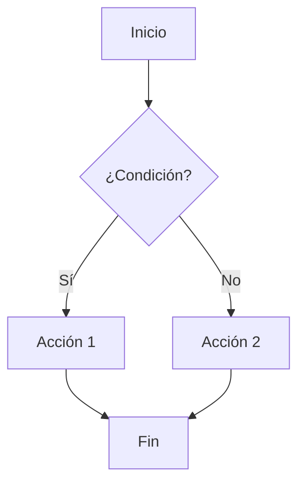
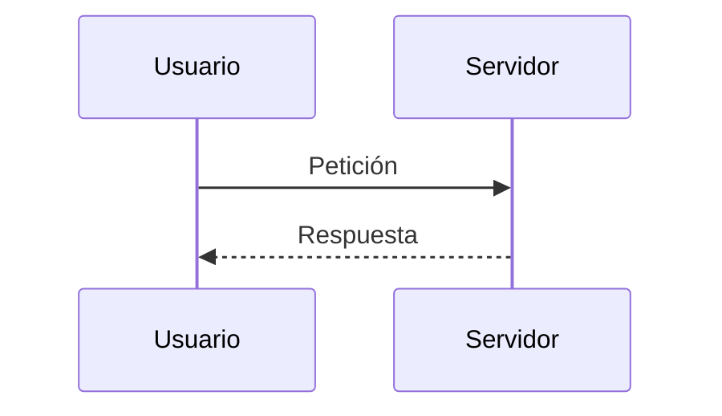
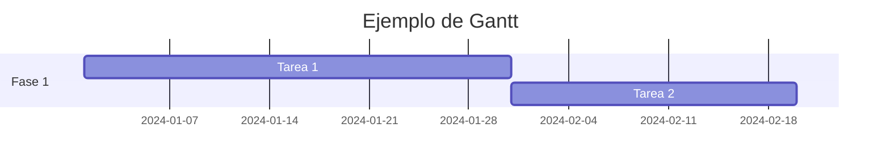

# Guía Completa de Markdown para Testing de Visores

Este documento contiene **todas las opciones posibles** de Markdown para probar un visor. Incluye sintaxis estándar, extensiones comunes y casos extremos.

---

## Tabla de Contenidos

- [1. Encabezados](#1-encabezados)
- [2. Énfasis y Formato](#2-énfasis-y-formato)
- [3. Listas](#3-listas)
- [4. Enlaces](#4-enlaces)
- [5. Imágenes](#5-imágenes)
- [6. Código](#6-código)
- [7. Citas](#7-citas)
- [8. Tablas](#8-tablas)
- [9. Líneas Horizontales](#9-líneas-horizontales)
- [10. Saltos de Línea](#10-saltos-de-línea)
- [11. HTML Inline](#11-html-inline)
- [12. Escapes](#12-escapes)
- [13. Footnotes](#13-footnotes)
- [14. Listas de Tareas](#14-listas-de-tareas)
- [15. Definiciones](#15-definiciones)
- [16. Emojis](#16-emojis)
- [17. Matemáticas](#17-matemáticas)
- [18. Diagramas](#18-diagramas)
- [19. Casos Extremos](#19-casos-extremos)

---

## 1. Encabezados

# H1 - Encabezado Nivel 1
## H2 - Encabezado Nivel 2
### H3 - Encabezado Nivel 3
#### H4 - Encabezado Nivel 4
##### H5 - Encabezado Nivel 5
###### H6 - Encabezado Nivel 6

### Encabezados alternativos (Setext)

Encabezado H1 Alternativo
=========================

Encabezado H2 Alternativo
-------------------------

### Encabezado con ID personalizado {#mi-id}

### Encabezado con *énfasis* y `código`

---

## 2. Énfasis y Formato

*Texto en cursiva* o _también cursiva_

**Texto en negrita** o __también negrita__

***Negrita y cursiva*** o ___también___

~~Texto tachado~~

==Texto resaltado== (extensión)

~Texto subrayado~ (extensión)

H~2~O (subíndice - extensión)

X^2^ (superíndice - extensión)

**Negrita con *cursiva anidada* dentro**

*Cursiva con **negrita anidada** dentro*

---

## 3. Listas

### Listas no ordenadas

- Elemento 1
- Elemento 2
  - Elemento 2.1
  - Elemento 2.2
    - Elemento 2.2.1
- Elemento 3

* Alternativa con asterisco
+ Alternativa con más

### Listas ordenadas

1. Primer elemento
2. Segundo elemento
   1. Sub-elemento 2.1
   2. Sub-elemento 2.2
      1. Elemento 2.2.1
         1. Elemento 2.2.1.1
3. Tercer elemento

### Listas ordenadas con inicio personalizado

5. Comienza en 5
6. Siguiente
7. Siguiente

### Listas mixtas

1. Elemento ordenado
   - Sub-elemento no ordenado
   - Otro sub-elemento
2. Segundo elemento ordenado
   1. Sub-elemento ordenado
   2. Otro sub-elemento

### Listas sueltas (con párrafos)

- Primer elemento

  Este es un párrafo dentro de un elemento de lista.

- Segundo elemento

  > Cita dentro de una lista

- Tercer elemento

  ```js
  const codigo = "dentro de lista";
  ```

- Cuarto elemento
  |Tabla|en|Lista|
  |---|---|---|
  |A|1|i|
  |B|2|ii|
  |C|3|iii|

### Listas de definición

Término 1
: Definición del término 1

Término 2
: Definición del término 2
: Segunda definición del término 2

---

## 4. Enlaces

[Enlace simple](https://www.ejemplo.com)

[Enlace con título](https://www.ejemplo.com "Título del enlace")

[Enlace de referencia][ref1]

[Enlace de referencia con texto diferente][ref1]

<https://www.enlace-automatico.com>

<correo@ejemplo.com>

[Enlace relativo](../ruta/relativa)

[Enlace a ancla](#1-encabezados)

https://www.enlace-sin-formato.com

[ref1]: https://www.ejemplo.com "Referencia 1"

### Enlaces con formato

[**Enlace en negrita**](https://ejemplo.com)

[*Enlace en cursiva*](https://ejemplo.com)

[`Enlace con código`](https://ejemplo.com)

---

## 5. Imágenes


![Imagen de referencia][img1]

[](https://ejemplo.com)


[img1]: https://via.placeholder.com/150 "Imagen de referencia"

### Imagen con HTML


---

## 6. Código

### Código inline

Usa `console.log()` para imprimir en consola.

Usa `` ` `` para escapar backticks.

### Bloque de código simple

```
Código sin lenguaje especificado
Línea 2
Línea 3
```

### Bloque con lenguaje (JavaScript)

```javascript
function saludar(nombre) {
  console.log(`Hola, ${nombre}!`);
  return true;
}

saludar("Mundo");
```

### Bloque con lenguaje (Python)

```python
def saludar(nombre: str) -> bool:
    """Docstring de ejemplo."""
    print(f"Hola, {nombre}!")
    return True

saludar("Mundo")
```

### Bloque con lenguaje (HTML)

```html
<!DOCTYPE html>
<html lang="es">
<head>
  <meta charset="UTF-8">
  <title>Ejemplo</title>
</head>
<body>
  <h1>Hola Mundo</h1>
</body>
</html>
```

### Bloque con lenguaje (CSS)

```css
body {
  font-family: Arial, sans-serif;
  color: #333;
  background: linear-gradient(45deg, #fff, #eee);
}
```

### Bloque con lenguaje (JSON)

```json
{
  "nombre": "Ejemplo",
  "valores": [1, 2, 3],
  "activo": true,
  "nulo": null
}
```

### Bloque con lenguaje (SQL)

```sql
SELECT id, nombre, email
FROM usuarios
WHERE activo = 1
ORDER BY nombre ASC;
```

### Bloque con lenguaje (Bash)

```bash
#!/bin/bash
echo "Hola Mundo"
for i in {1..5}; do
  echo "Iteración $i"
done
```

### Bloque con lenguaje (Diff)

```diff
- línea eliminada
+ línea añadida
  línea sin cambios
```

### Bloque con resaltado de líneas

```js {1,3-4}
const a = 1;  // resaltada
const b = 2;
const c = 3;  // resaltada
const d = 4;  // resaltada
```

### Código con backticks anidados

````markdown
```javascript
const x = "código dentro de código";
```
````

---

## 7. Citas

> Cita simple de una línea.

> Cita de múltiples líneas.
> Continúa aquí.
> Y aquí.

> Cita con **negrita** y *cursiva*.
>
> > Cita anidada.
> >
> > > Cita anidada más profunda.

> ### Encabezado dentro de cita
>
> - Lista dentro de cita
> - Otro elemento
>
> ```js
> const enCita = true;
> ```

> Cita con
> salto de línea forzado.

---

## 8. Tablas

### Tabla básica

| Columna 1 | Columna 2 | Columna 3 |
|-----------|-----------|-----------|
| A         | B         | C         |
| D         | E         | F         |

### Tabla con alineación

| Izquierda | Centro | Derecha |
|:----------|:------:|--------:|
| Texto     | Texto  | Texto   |
| Más       | Más    | Más     |

### Tabla con formato inline

| Formato    | Ejemplo                |
|------------|------------------------|
| Negrita    | **texto**              |
| Cursiva    | *texto*                |
| Código     | `código`               |
| Enlace     | [link](https://a.com)  |

### Tabla con celdas vacías

| A | B | C |
|---|---|---|
| 1 |   | 3 |
|   | 2 |   |

### Tabla con pipes escapados

| Columna |
|---------|
| a \| b  |
| c \| d  |

### Tabla con HTML

| Columna | Valor |
|---------|-------|
| Fila    | <b>Negrita HTML</b> |

---

## 9. Líneas Horizontales

---

***

___

- - -

* * *

_ _ _

---

## 10. Saltos de Línea

Línea 1  
Línea 2 (dos espacios al final)

Línea 3\
Línea 4 (backslash al final)

Línea 5

Línea 6 (párrafo separado)

---

## 11. HTML Inline

Texto con <b>negrita HTML</b>, <i>cursiva</i>, <u>subrayado</u>.

Texto con <span style="color: red;">color rojo</span>.

Texto con <mark>resaltado</mark>.

Texto con <kbd>Ctrl</kbd> + <kbd>C</kbd>.

<details>
<summary>Click para expandir</summary>

Contenido oculto que se muestra al hacer clic.

- Elemento 1
- Elemento 2

</details>

<br>

<hr>

<sub>Texto subíndice</sub> y <sup>Texto superíndice</sup>

<abbr title="HyperText Markup Language">HTML</abbr>

<cite>Referencia bibliográfica</cite>

<del>Texto eliminado</del> y <ins>Texto insertado</ins>

---

## 12. Escapes

\*Asterisco escapado\*

\_Guion bajo escapado\_

\`Backtick escapado\`

\# Almohadilla escapada

\[Corchete escapado\]

\\ Barra invertida

\~ Tilde escapada

\| Pipe escapado

---

## 13. Footnotes

Este es un texto con nota al pie[^1].

Otra nota al pie con nombre[^nota-nombre].

[^1]: Contenido de la nota al pie número 1.

[^nota-nombre]: Contenido de la nota con nombre personalizado.
    Puede tener múltiples líneas.

---

## 14. Listas de Tareas

- [x] Tarea completada
- [ ] Tarea pendiente
- [x] Otra tarea completada
  - [x] Subtarea completada
  - [ ] Subtarea pendiente
- [ ] Tarea con **formato**

---

## 15. Definiciones

Manzana
: Fruta roja o verde.

Naranja
: Fruta cítrica.
: Color entre rojo y amarillo.

---

## 16. Emojis

:smile: :heart: :rocket: :thumbsup: :warning: :bug: :sparkles:

Emojis Unicode directos: 😀 ❤️ 🚀 👍 ⚠️ 🐛 ✨

---

## 17. Matemáticas

### Inline

La fórmula $E = mc^2$ es famosa.

La ecuación \(a^2 + b^2 = c^2\) es pitagórica.

### Bloque

$$
\int_{0}^{\infty} e^{-x^2} dx = \frac{\sqrt{\pi}}{2}
$$

$$
\begin{pmatrix}
a & b \\
c & d
\end{pmatrix}
$$

---

## 18. Diagramas

### Mermaid - Flowchart



### Mermaid - Sequence



### Mermaid - Gantt



---

## 19. Casos Extremos

### Caracteres especiales

& < > " ' © ® ™ € £ ¥ § ¶ † ‡ • … ‰ ′ ″ ‹ › « »

### Unicode

á é í ó ú ñ ü Á É Í Ó Ú Ñ Ü

中文 日本語 한국어 العربية עברית русский

### Texto largo sin espacios

EstoEsUnaPalabraMuyLargaSinEspaciosQueDeberiaRomperElDisenoDelVisorSiNoSeManejaCorrectamenteEstoEsUnaPalabraMuyLargaSinEspacios.

### Anidamiento profundo

> Nivel 1
> > Nivel 2
> > > Nivel 3
> > > > Nivel 4
> > > > > Nivel 5

### Lista con muchos niveles

- Nivel 1
  - Nivel 2
    - Nivel 3
      - Nivel 4
        - Nivel 5
          - Nivel 6

### Combinación de todo

> ### Título en cita
>
> Texto con **negrita**, *cursiva*, `código` y [enlace](https://ejemplo.com).
>
> | Tabla | En   |
> |-------|------|
> | Cita  | Sí   |
>
> - [x] Tarea en cita
> - [ ] Otra tarea
>
> ```python
> print("código en cita")
> ```

### Referencias no definidas

[Enlace roto][no-existe]

### Imagen rota


### Tabla malformada

| A | B
|---|---|
| 1 | 2 | 3

### HTML complejo

<div style="border: 2px solid #333; padding: 10px; border-radius: 5px;">
  <h4>Div con estilos</h4>
  <p>Contenido dentro de un div con <strong>estilos inline</strong>.</p>
  <ul>
    <li>Item HTML 1</li>
    <li>Item HTML 2</li>
  </ul>
</div>

---

## Conclusión

Este documento cubre:

- ✅ Sintaxis estándar de Markdown
- ✅ Extensiones comunes (GFM, footnotes, tareas)
- ✅ HTML inline y en bloque
- ✅ Matemáticas (LaTeX)
- ✅ Diagramas (Mermaid)
- ✅ Casos extremos y errores

**Fin del documento de testing.**
